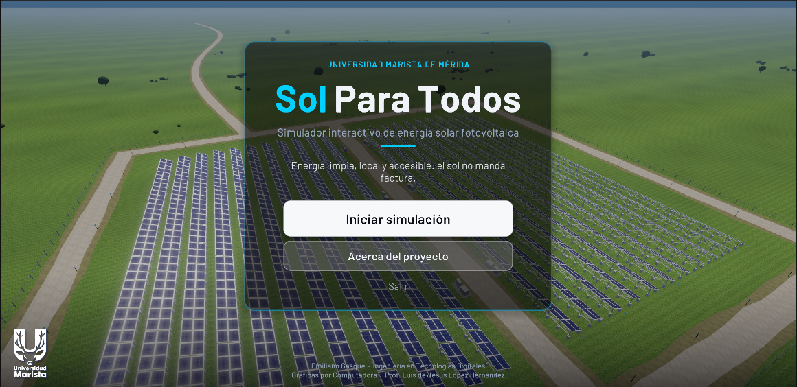
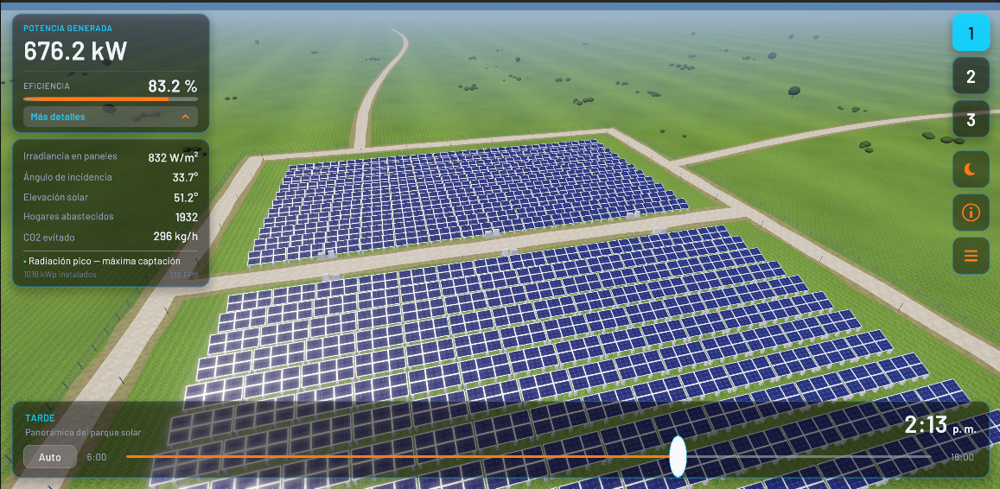
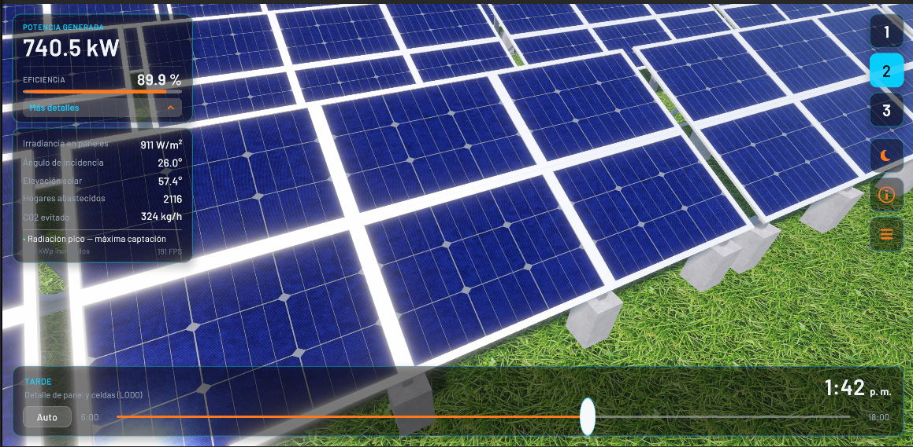
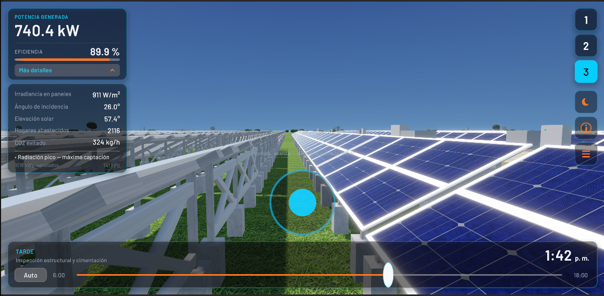
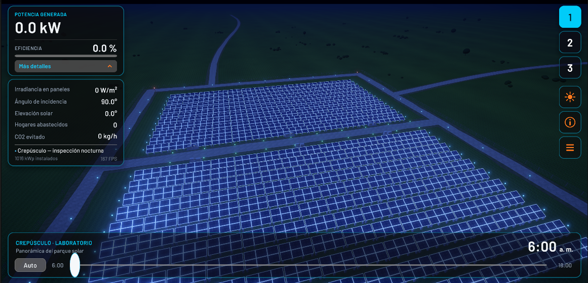
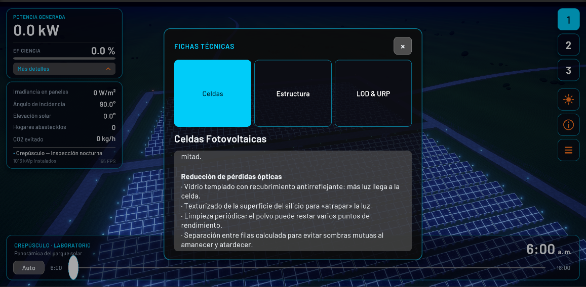

# Sol Para Todos

Simulación interactiva en 3D de un campo fotovoltaico para Android, hecha con **Unity 6 (6000.6.3f1)** y **URP**, con el modelo del panel en **Blender**.
Proyecto de **Gráficas por Computadora**, Universidad Marista de Mérida.

**Autor:** Emiliano Gasque · Ingeniería en Tecnologías Digitales
**Profesor:** Luis de Jesús López Hernández

La app muestra cómo la hora del día, la inclinación de los paneles y la sombra cambian la energía que genera un campo solar. No vende nada: es una herramienta para entender y divulgar la energía solar.

| Dato | Valor |
| --- | --- |
| Versión | 0.1.0 |
| Plataforma | Android 8.0 o superior (ARM64, IL2CPP) |
| Motor | Unity 6 (6000.6.3f1) con Universal Render Pipeline (móvil) |
| Escena principal | `Assets/Scenes/SampleScene.unity` |
| Tamaño del APK | 48.7 MB |

---

## 0. Uso rápido

1. Abre el proyecto con **Unity 6000.6.3f1** (Unity Hub > Add > carpeta del proyecto).
2. Si Unity lo pide, importa **TMP Essentials**: `Window > TextMeshPro > Import TMP Essential Resources`.
3. Abre `Assets/Scenes/SampleScene.unity`.
4. Ejecuta **`Tools > Sol Para Todos > Construir Escena Completa y UI`**. Reordena la granja, crea el terreno, el cielo, los inversores, la cerca, el modo noche y toda la interfaz, y conecta las referencias del controlador. Se puede ejecutar las veces que haga falta: reemplaza lo que generó antes sin tocar tus objetos.
5. Guarda la escena (`Ctrl+S`) y pulsa **Play**.
6. Para Android: `File > Build Profiles > Android`, escena `SampleScene`, Scripting Backend **IL2CPP**, arquitectura **ARM64**, Minimum API Level **26 (Android 8.0)**. Luego **Build** o **Build And Run**.

Al terminar, el constructor escribe un informe en `Assets/SolParaTodos/Settings/SPT_UltimoInforme.txt`. Si algo falla, la línea que empieza con «ERROR en…» dice qué parte fue.

Otros comandos del menú `Tools > Sol Para Todos`:

| Comando | Qué hace |
| --- | --- |
| Tamaño de la granja | Compacta (192 paneles), Estándar (308) o Grande (480). Después hay que volver a construir. |
| Verificar SRP Batcher, Materiales y LODs | Revisa compatibilidad de materiales y los LOD Group de los paneles. |
| Unificar Materiales Duplicados de Paneles | Deja un solo material compartido para las celdas. |
| Restaurar sombras URP originales | Regresa la distancia de sombras que tenía tu asset de URP. |
| Eliminar Objetos Generados | Borra todo lo que creó el constructor. |
| Abrir Guía Rápida | Abre `Assets/SolParaTodos/LEEME_SolParaTodos.md`. |

---

## 1. Estructura y flujo

### Carpetas

```
Documentacion/capturas/                Capturas de la app (se usan en este README)
Assets/
├─ Editor/
│   └─ SolParaTodosSceneBuilder.cs     Constructor de la escena y la interfaz (menú Tools)
├─ Scenes/                             SampleScene
├─ Panel_LOD.fbx · Panel.fbx           Modelo del panel (Blender), con 3 niveles de detalle
├─ Materials/ · Textures/              Materiales y texturas originales del proyecto
├─ Settings/                           Mobile_RPAsset (URP)
└─ SolParaTodos/
    ├─ Scripts/                        Código de la app
    ├─ Shaders/                        SPT_SkyGradient (cielo con degradado y estrellas)
    ├─ Fuentes/                        Barlow (OFL)
    ├─ Materiales/                     Grava, pasto, inversores, cerca, vegetación…
    ├─ Mallas/                         Terreno y mallas combinadas generadas
    ├─ UI/                             Sprites de la interfaz y logo de la universidad
    └─ Settings/                       Perfil del modo noche, informe del constructor
```

### Flujo entre pantallas

```
Menú de inicio ──► Iniciar simulación ──► HUD de simulación
      │                                      ├─ Vista 1: panorámica
      ├─► Acerca del proyecto                ├─ Vista 2: detalle de un panel
      └─► Salir                              └─ Vista 3: recorrido con joystick
                                          (Fichas técnicas · Modo noche · Menú)
```

### Jerarquía de la escena

```
SampleScene
├─ Directional Light            El controlador la gira según la hora
├─ Camera                       Cámara principal (anclas de vista)
├─ Pasto                        Disco de terreno (5.2 km) con niebla
├─ Campo
│   └─ Fila 01 … Fila 22        14 paneles por fila (instancias del prefab, sin modificarlo)
├─ SPT_Calles                   Caminos de grava con borde de tierra
├─ SPT_Inversores               Casetas blancas con LED de estado
├─ SPT_Entorno                  Cerca, arbustos y árboles
├─ SPT_Indicadores              Balizas y farolas (se encienden de noche)
├─ SPT_Vistas                   Anclas de las tres vistas
├─ SPT_VolumenNocturno          Volume global para el modo noche
├─ SPT_SolarField               SolarFieldController (cerebro de la app)
└─ Canvas                       Menú, HUD, fichas y ventana «Acerca del proyecto»
```

### Distribución del HUD

| Zona | Contenido |
| --- | --- |
| Arriba a la izquierda | Panel de telemetría translúcido: **Potencia (kW)** y **Eficiencia (%)** siempre visibles; «Más detalles» despliega irradiancia, ángulo, elevación, hogares abastecidos, CO₂ evitado y FPS |
| Arriba a la derecha | Riel compacto de botones: vistas 1-2-3, modo noche, fichas técnicas, menú |
| Abajo | Reloj de ancho fijo y barra de hora (6:00 a 18:00) |
| Vista 3 | Joystick virtual y área de arrastre para mirar |

---

## 2. Scripts

| Script | Función |
| --- | --- |
| `SolarFieldController.cs` | Controlador principal. Ciclo solar por hora, telemetría con producto punto entre el sol y la normal de cada panel, indicadores de rendimiento, modo día/noche (cielo, niebla y ambiente), las 3 vistas, despliegue de «Más detalles» y estados de la interfaz. |
| `SPTVirtualJoystick.cs` | Joystick táctil para recorrer el pasillo en la Vista 3. |
| `SPTTouchLookArea.cs` | Arrastre para mirar u orbitar y pellizco para acercar. |
| `SPTResponsiveCanvas.cs` | Ajusta el CanvasScaler en vertical u horizontal y respeta el área segura (notch). |
| `SPTPhraseRotator.cs` | Rota las frases del menú de inicio. |
| `SPTButtonFeedback.cs` | Micro-animación al presionar los botones. |
| `SPTGenerado.cs` | Marcador: identifica lo que creó el constructor para poder reconstruir sin tocar tu escena. |
| `Editor/SolParaTodosSceneBuilder.cs` | Constructor completo de la escena y la interfaz (menú `Tools > Sol Para Todos`). |

**Cálculo de la eficiencia.** Para cada panel se toma el producto punto entre la dirección del sol y la normal del panel (`Vector3.Dot`). Con incidencia perpendicular vale 1 (100 %); a 60° se aprovecha la mitad. La irradiancia se atenúa con la masa de aire cuando el sol está bajo. La simulación asume módulos de 550 Wp y un Performance Ratio de 0.80.

---

## 3. Materiales, LOD y rendimiento

- **Paneles:** cada unidad usa un LOD Group de 3 niveles (`Panel_LOD0`, `LOD1`, `LOD2`). El modelo y su prefab no se modifican; el constructor solo coloca instancias.
- **Material de celdas:** un solo material compartido. El brillo y el color por panel se aplican con `MaterialPropertyBlock`, para no romper el SRP Batcher.
- **Terreno:** malla de disco generada por código, con UV en mosaico de 3.5 m, mapa de variación a gran escala y niebla lineal (220–1100 m) del mismo color que el horizonte del cielo.
- **Cielo:** shader propio `SPT_SkyGradient` con degradado, sol y estrellas de noche.
- **Entorno:** caminos, cerca, arbustos y árboles se combinan en pocas mallas de pocos polígonos.
- **Modo Crepúsculo:** ambiente azul oscuro, luna, Bloom y balizas emisivas azules, verdes y rojas que dibujan la silueta de la granja.
- **Ajustes de rendimiento para móvil:** MSAA 4x, SRP Batcher, distancia de sombras de 90 m y LOD Bias en 1. En una granja de 308 paneles, el tamaño «Compacta» reduce de forma notable triángulos y draw calls.

---

## 4. Textos

- **Título:** «Sol Para Todos», con el subtítulo «Simulador interactivo de energía solar fotovoltaica».
- **Frases del menú:** seis frases sobre el potencial solar y la transición energética. Están en `Frases` dentro de `SolParaTodosSceneBuilder.cs`.
- **Fichas técnicas:** tres fichas, «Celdas Fotovoltaicas», «Estructura y Soporte» y «Optimización Gráfica (LOD & URP)». Están en `SolarFieldController.FichasTitulosPorDefecto` y `FichasCuerposPorDefecto`.
- **Acerca del proyecto:** `TextoAcerca` en el constructor.

---

## 5. Capturas

**Menú de inicio**



**Vista 1: panorámica del campo, con «Más detalles» desplegado**



**Vista 2: detalle de los paneles y sus celdas**



**Vista 3: recorrido entre las filas con joystick**



**Modo Crepúsculo / Noche de Laboratorio**



**Fichas técnicas**



---

## 6. Ajustes frecuentes

| Quiero… | Dónde |
| --- | --- |
| Cambiar el tamaño de la granja | `Tools > Sol Para Todos > Tamaño de la granja` y volver a construir |
| Hacer el pasto más grande o más chico | `TamMosaicoPasto` en `SolParaTodosSceneBuilder.cs` |
| Cambiar la niebla | `NieblaInicio` y `NieblaFin` en el constructor |
| Cambiar la hora inicial | Campo `hora` de `SolarFieldController` |
| Cambiar los colores del día y la noche | Paletas del `SolarFieldController` (inspector) |
| Ajustar el tamaño o la posición del logo del menú | Objeto `LogoMarista` dentro de `MenuInicio` |
| Cambiar la fuente | `Assets/SolParaTodos/Fuentes/` y volver a construir |
| Bajar la carga en un teléfono lento | Tamaño «Compacta» y menos distancia de sombras en `Mobile_RPAsset` |

---

## Créditos y licencias

- Autor: Emiliano Gasque, Universidad Marista de Mérida.
